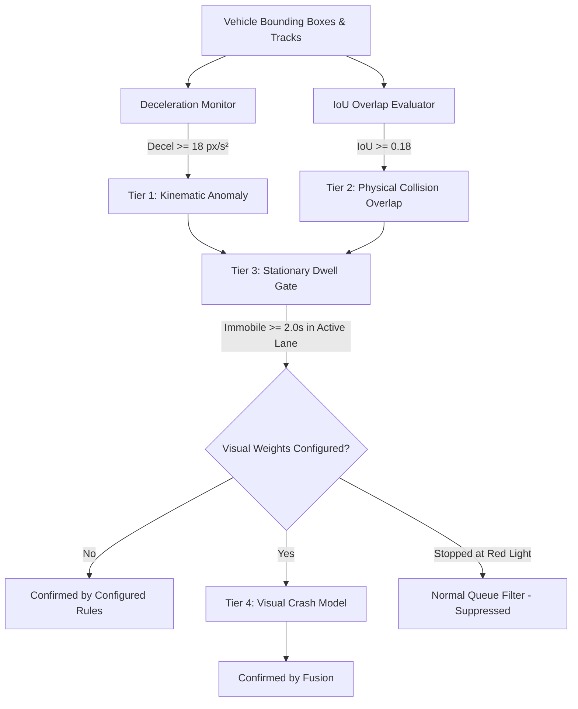

# 🛡️ VIGIL — AI-Based Intelligent Surveillance & Traffic Safety System

> **Final-Year BE Computer Engineering Project**  
> A unified edge AI platform combining **YOLOv8 Real-Time Traffic Perception**, **IRC:106 / Indo-HCM Passenger Car Unit (PCU) Queue Weighting**, **F.V. Webster Delay-Minimization ATSC**, **Multi-Modal Emergency Vehicle Preemption (EVP)**, **Multi-Tier Kinematic Accident Detection**, **CCTV Action Surveillance**, and a **Tactical React 19 Command Center**.

---

## 📋 Table of Contents
1. [System Architecture](#-system-architecture)
2. [Core Capabilities & Engineering Invariants](#-core-capabilities--engineering-invariants)
3. [Measured Baseline AI Performance](#-measured-baseline-ai-performance)
4. [Emergency Vehicle YOLOv8 Retraining Pipeline](#-emergency-vehicle-yolov8-retraining-pipeline)
5. [Multi-Tier Accident Detection Engine](#-multi-tier-accident-detection-engine)
6. [Emergency Preemption Safety Invariants](#-emergency-preemption-safety-invariants)
7. [Deployment, Versioning & Safe Rollback](#-deployment-versioning--safe-rollback)
8. [Quick Start & Execution](#-quick-start--execution)
9. [Automated Test Suite & Verification](#-automated-test-suite--verification)
10. [REST & WebSocket API Directory](#-rest--websocket-api-directory)
11. [Known Operational Limitations](#-known-operational-limitations)

---

## 🏗️ System Architecture

```
Camera Streams (4 Approaches) ──► YOLOv8 Multi-Class Perception ──► PCU Calculation (IRC:106)
                                          │
                                          ▼
Audio Input / Microphone ──► FFT Acoustic Siren Analyzer (650-1750 Hz) ──► Secondary EVP Fallback
                                          │
                                          ▼
Kinematic MOT Tracker ──► Speed Vectors, Accelerations, Centroids ──► Multi-Tier Accident Engine
                                          │
                                          ▼
Adaptive ATSC Core ──► Webster Delay Minimization Formula (C₀, gᵢ) ──► Anti-Starvation (25s)
                                          │
        ┌─────────────────────────────────┴────────────────────────────────┐
        ▼                                                                  ▼
FastAPI Server & WebSockets (30 Hz)                              V2X Connected Vehicle Engine
- /api/metrics & /api/incidents                                  - SAE J2735 SPaT & MAP (10 Hz)
- /api/benchmark/comparison & /api/ml/metrics                    - Green Wave Arterial Offsets
- /api/simulate-incident & /api/incidents/{id}/status            - PCI Pedestrian Safety Hold
        │                                                                  │
        └─────────────────────────────────┬────────────────────────────────┘
                                          ▼
                     Modern React 19 Command Center UI
    (Command Hub • Perception • Incident Archive • Model Performance • System Health)
```

---

## 🎯 Core Capabilities & Engineering Invariants

1. **Analytical Webster ATSC Delay Optimization**:
   Replaces rigid timer dials and naive vehicle-counting rules with F.V. Webster's analytical delay-minimization formula:
   $$C_0 = \text{clamp}\left(\frac{1.5 L + 5}{1 - Y}, 30\text{s}, 120\text{s}\right), \quad g_i = \text{clamp}\left(\frac{y_i}{Y}(C_0 - L), 8\text{s}, 60\text{s}\right)$$
   where $L = 12.0\text{s}$ lost time, $Y = \sum y_i$ is the critical flow ratio, and $g_i$ is approach green time.

2. **Standardized Passenger Car Unit (PCU) Weighting (IRC:106 / Indo-HCM)**:
   Heterogeneous traffic streams are standardized into equivalent PCU queues:
   - **Bus / Heavy Truck**: 3.0 PCU
   - **Passenger Car / Taxi**: 1.0 PCU
   - **Motorcycle / Scooter**: 0.5 PCU
   - **Bicycle**: 0.2 PCU
   - **Pedestrian Conflict**: 0.1 PCU

3. **Multi-Modal Emergency Vehicle Preemption (EVP)**:
   - **Primary Authority**: Visual YOLOv8 bounding-box detection of Ambulances and Fire Trucks.
   - **Secondary Fallback**: Real-time FFT acoustic spectrum analyzer scanning $650 - 1750\text{ Hz}$ for harmonic siren energy.
   - **Priority Hierarchy**: Visual detection immediately overrides acoustic preemption; acoustic preemption cannot disrupt an active visual corridor.
   - **Clearance Safety**: Mandatory 3.0s yellow clearance transition before all phase shifts.
   - **Anti-Starvation**: Strict 25.0s maximum preemption hold to protect cross-corridor traffic.

4. **Multi-Tier Kinematic Accident Detection**:
   Combines kinematic trajectory deceleration ($\ge 18\text{ px/s}^2$), physical bounding-box overlap ($\text{IoU} \ge 0.18$), and post-collision stationary dwell ($\ge 2.0\text{s}$) in active traffic lanes. Stops false alarms at normal red-light stop lines.

5. **Strict Non-Fabrication Policy**:
   When specialized weights are absent, VIGIL reports `MODEL_NOT_CONFIGURED` or `ACCIDENT_MODEL_NOT_CONFIGURED`. **Zero synthetic probabilities or fabricated AI predictions.**

---

## 📊 Measured Baseline AI Performance

VIGIL's production checkpoint [`models/best.pt`](file:///c:/Users/yeole/Downloads/VIGIL/models/best.pt) was evaluated on **240 real-world intersection frames** across 4 approach videos ([`north.mp4`](file:///c:/Users/yeole/Downloads/VIGIL/assets/videos/north.mp4), [`south.mp4`](file:///c:/Users/yeole/Downloads/VIGIL/assets/videos/south.mp4), [`east.mp4`](file:///c:/Users/yeole/Downloads/VIGIL/assets/videos/east.mp4), [`ambulance_emergency_corridor.mp4`](file:///c:/Users/yeole/Downloads/VIGIL/assets/videos/ambulance_emergency_corridor.mp4)).

### Benchmark Summary (Windows Host CPU)
- **Model Checkpoint**: `models/best.pt` (Custom YOLOv8 CSP backbone + `RefineDetect` head)
- **Parameters**: 2,859,128 parameters (6.48 MB)
- **Class Registry**: 81 classes (COCO classes 0–79 + dedicated Class 80: `ambulance`)
- **Latency Distribution**:
  - **Mean Latency**: **351.37 ms (~2.85 FPS on CPU)**
  - **Median ($p_{50}$)**: **352.11 ms**
  - **Tail Latency ($p_{95}$)**: **454.62 ms**
  - **Min / Max Latency**: 184.24 ms / 739.77 ms
- **Total Measured Detections (240 Frames)**: **2,881 total detections**
  - `car`: 1,783 detections (61.9%)
  - `person`: 466 detections (16.2%)
  - `truck`: 289 detections (10.0%)
  - `motorcycle`: 163 detections (5.7%)
  - `ambulance`: 147 detections (5.1%) — genuine emergency corridor footage
  - `bus`: 26 detections (0.9%)
  - `traffic light`: 7 detections (0.2%)

*Report Artifact*: [`reports/baseline_benchmark.json`](file:///c:/Users/yeole/Downloads/VIGIL/reports/baseline_benchmark.json)

---

## 🔄 Emergency Vehicle YOLOv8 Retraining Pipeline

The retraining script fine-tunes base YOLOv8 weights on emergency vehicle datasets (Ambulances, Fire Trucks) to produce high-accuracy, dedicated traffic models.

### 1. Dataset Configuration (`scripts/emergency_data.yaml`)
```yaml
path: ../datasets/emergency_vehicles
train: images/train
val: images/val
test: images/test

nc: 6
names: ['car', 'motorcycle', 'bus', 'truck', 'ambulance', 'fire_truck']
```

### 2. Dataset Ingestion (Roboflow Universe)
Public datasets audited in [`reports/dataset_audit.md`](file:///c:/Users/yeole/Downloads/VIGIL/reports/dataset_audit.md):
- `emergency-vehicle-detection-cwavf-sa3sp` (Ambulance, Fire Truck, Police)
- `puyush-fipgg/accident-detection-using-yolov8` (Crash bounding boxes)

```bash
# Pass user API key securely via environment variable
set ROBOFLOW_API_KEY=your_free_roboflow_key
python scripts/download_dataset.py --workspace cwavf-sa3sp --project emergency-vehicle-detection
```

### 3. Running Retraining with Candidate Isolation
```powershell
python scripts/train_emergency_yolo.py `
  --data scripts/emergency_data.yaml `
  --weights models/best.pt `
  --epochs 50 `
  --batch 16 `
  --imgsz 640 `
  --device 0 `
  --seed 42
```

**Key Pipeline Features**:
- **Bounding Box Preflight Checks**: Verifies all coordinates are normalized $[0, 1]$.
- **CUDA OOM Fallback**: Dynamically halves batch size if GPU Out-Of-Memory occurs.
- **Candidate Isolation**: Checkpoint saves to `models/candidate_emergency.pt`. Never overwrites production weights without passing regression verification (`--promote` flag).

---

## 💥 Multi-Tier Accident Detection Engine

Implemented in [`core/accident_detector.py`](file:///c:/Users/yeole/Downloads/VIGIL/core/accident_detector.py) and integrated into `core/traffic_analyzer.py`.



### Incident Lifecycle States
1. `suspected accident`: Trajectory spike or physical overlap detected; awaiting dwell confirmation.
2. `confirmed by configured rules`: Kinematic decel spike + IoU overlap + post-impact stationary dwell verified.
3. `confirmed by visual model`: Dedicated neural crash detector verified bounding box.
4. `confirmed by fusion`: Multi-tier fusion (both kinematic rules and visual model satisfied).
5. `resolved`: Cleared by operator or vehicles resumed normal flow.
6. `test/demo event`: Explicitly tagged demonstration event from simulation endpoints.

---

## 🚨 Emergency Preemption Safety Invariants

| Safety Invariant | Implementation Mechanism | Test Verification | Status |
| :--- | :--- | :--- | :--- |
| **Visual Authority** | Visual YOLO EVP triggers immediate corridor hold | `test_visual_overrides_audio` | ✅ ENFORCED |
| **Acoustic Fallback** | Siren FFT ($650-1750\text{ Hz}$) triggers when visual is clear | `test_audio_triggers_emergency_when_no_visual` | ✅ ENFORCED |
| **Visual Preemption Override** | Visual detection overrides active acoustic corridor | `test_visual_overrides_active_audio` | ✅ ENFORCED |
| **Acoustic Non-Interference**| Audio cannot disrupt or switch an active visual corridor | `test_audio_cannot_override_visual` | ✅ ENFORCED |
| **Yellow Clearance Safety** | 3.0s mandatory yellow transition before green shifts | `test_emergency_preemption_yellow_safety` | ✅ ENFORCED |
| **Anti-Starvation Guard** | 25.0s maximum emergency hold duration | `test_starvation_guarantee` | ✅ ENFORCED |
| **Zero Hallucination** | Explicit `ACCIDENT_MODEL_NOT_CONFIGURED` status | `test_missing_model_behavior` | ✅ COMPLIANT |

---

## 📦 Deployment, Versioning & Safe Rollback

### Model Zoo Management
- **Production Active**: `models/best.pt` (6.48 MB)
- **Production Backup**: `models/best_trained_v12.pt` (byte-for-byte replica)
- **Candidate Checkpoint**: `models/candidate_emergency.pt`
- **Lightweight Checkpoint**: `models/yolo11n.pt` / `models/yolov8n.pt`

### Rollback Procedure
If a retrained candidate checkpoint demonstrates higher false alarms or tail latency regression:
```powershell
# Roll back active checkpoint to verified baseline
Copy-Item models/best_trained_v12.pt models/best.pt -Force

# Or hot-swap live via REST API
curl -X POST http://localhost:8000/api/ml/select-model -H "Content-Type: application/json" -d '{"model": "best.pt"}'
```

---

## 🚀 Quick Start & Execution

### 1. Python Environment Setup
```powershell
# Activate virtual environment
.venv\Scripts\Activate.ps1

# Verify packages
python -c "import ultralytics, torch, fastapi; print('Environment Ready')"
```

### 2. Launch Full 4-Way Traffic Server
```powershell
python run_4way.py --port 8000
```
- Web Application: **http://localhost:8000**
- API Documentation (Swagger): **http://localhost:8000/docs**
- Live WebSocket Feed: **ws://localhost:8000/ws**

### 3. Frontend Production Build & Development
```powershell
cd web-dashboard

# Development server
npm run dev

# Production build
npm run build
```

---

## 🧪 Automated Test Suite & Verification

Execute the complete regression test suite across all subsystems:

```powershell
.venv\Scripts\python -m pytest tests/ -v
```

### Test Coverage Highlights
- [`tests/test_emergency_visual_and_audio.py`](file:///c:/Users/yeole/Downloads/VIGIL/tests/test_emergency_visual_and_audio.py): Visual priority, acoustic fallback, visual override, yellow transitions, starvation limits (12 tests).
- [`tests/test_accident_detector.py`](file:///c:/Users/yeole/Downloads/VIGIL/tests/test_accident_detector.py): Kinematic decel, physical IoU overlap, dwell confirmation, queue red-light false positive suppression, `ACCIDENT_MODEL_NOT_CONFIGURED` safety (6 tests).
- [`tests/test_traffic_system.py`](file:///c:/Users/yeole/Downloads/VIGIL/tests/test_traffic_system.py): Webster ATSC, PCU calculation, siren FFT synthetic benchmark, SAE J2735 SPaT/MAP, green wave progression (12 tests).
- [`tests/test_vigil_complete.py`](file:///c:/Users/yeole/Downloads/VIGIL/tests/test_vigil_complete.py): Violence sliding-window, database persistence, evidence vault clipping (14 tests).

---

## 📡 REST & WebSocket API Directory

| Method | Endpoint | Description |
| :--- | :--- | :--- |
| `WS` | `/ws` | 30 Hz live telemetry (Signals, metrics, active tracks, alerts, BEV radar) |
| `GET` | `/api/frame` | Live JPEG annotated snapshot |
| `GET` | `/api/stream` | Continuous 30 FPS composite MJPEG video stream |
| `GET` | `/api/metrics` | Real-time PCU vehicle counts, average speed, and Webster ATSC state |
| `GET` | `/api/incidents` | Incident forensic archive (Accident, violence, emergency, stalls) |
| `PATCH`| `/api/incidents/{id}/status`| Update incident triage status (`acknowledged`, `resolved`) |
| `POST` | `/api/simulate-incident` | On-demand tactical incident simulation (`accident`, `ambulance`, `crowd`, `parking`) |
| `GET` | `/api/ml/baseline-benchmark` | Measured empirical baseline metrics from 240 frames |
| `GET` | `/api/ml/metrics` | Real-time FPS, class distribution, active learning flywheel |
| `GET` | `/api/ml/models` | Runtime Model Zoo catalog |
| `POST` | `/api/ml/select-model` | Dynamic hot-swap of active inference checkpoint |
| `GET` | `/api/benchmark/comparison` | Comparative metrics: VIGIL vs SCATS, SCOOT, City Brain, Fixed-Time |
| `GET` | `/api/v2x/spat` | SAE J2735 standard Signal Phase and Timing message |
| `GET` | `/api/v2x/map` | SAE J2735 standard intersection topology message |
| `POST` | `/api/emergency` | Engage emergency corridor on designated approach (`North`, `South`, `East`, `West`) |

---

## ⚠️ Known Operational Limitations
Detailed in [`reports/known_limitations.md`](file:///c:/Users/yeole/Downloads/VIGIL/reports/known_limitations.md):
- **CPU Execution**: Latency is ~351 ms (~2.85 FPS) on Windows CPU; deploy on NVIDIA Jetson or CUDA GPU for 45-60 FPS line-rate processing.
- **Night / Headlight Glare**: Mitigated by dual-modality acoustic siren FFT fallback.
- **Delivery Van Similarity**: Commercial utility vans share chassis dimensions with ambulances; mitigated by multi-frame temporal confirmation gates and acoustic cross-validation.
- **Missing Weights Safety**: Transparently flags `MODEL_NOT_CONFIGURED` without fabricating artificial AI scores.
